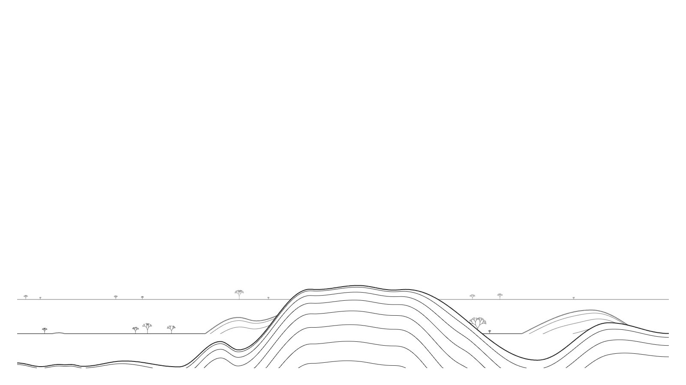
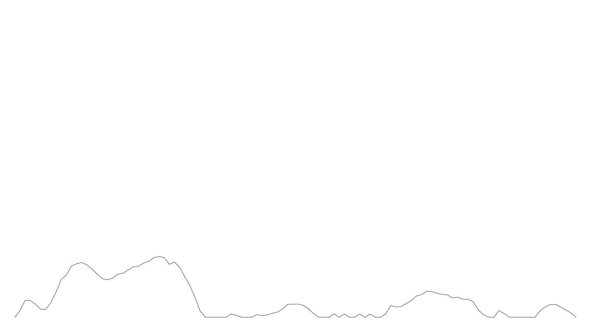
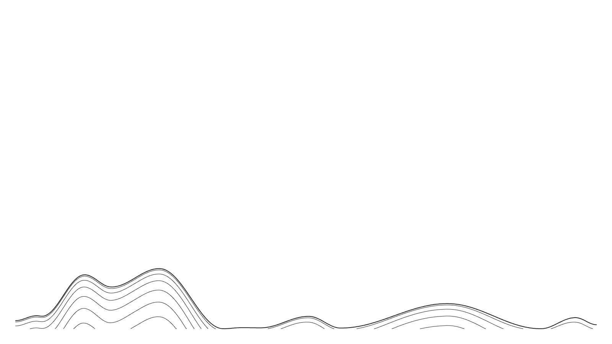
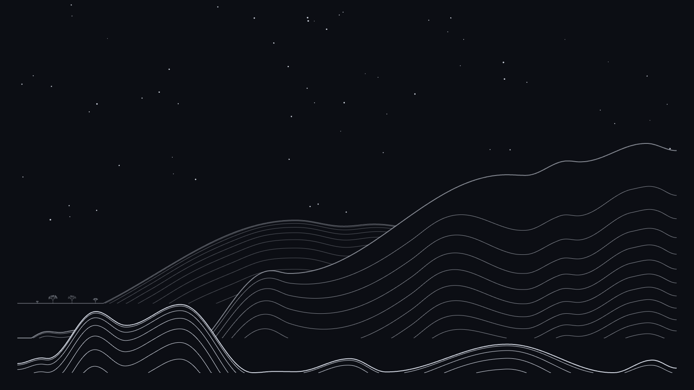

# Keyscape

Type, stop for five seconds, and your key presses get drawn as a line-art mountain range. Plain JavaScript on a `<canvas>`, no libraries.



Try it live at **[keyscape-4fp.pages.dev](https://keyscape-4fp.pages.dev/)** (hosted on Cloudflare Pages). To run it locally, open `index.html` in a browser.

## The pipeline

Everything lives in `script.js`. The data goes through these steps:

```
key press -> code number -> jagged line -> smooth ridge -> 3 layered ranges -> thin lines -> trees -> stars
```

Every frame redraws the whole picture from scratch (`drawScene`). Nothing is stored as pixels, so the animation is just "draw everything again with a later time".

## 1. Keys become numbers

`handleKeyPress` runs on every key and stores two things:

- **a code**, from `keyToCode`: `Math.floor(Math.random() * charCode)`. The random part means the same text gives a different landscape each time.
- **a roughness**, from `measureRoughness`. It measures the pause since the last key. A pause of 120ms or less gives `1.1`, 600ms or more gives `0.4`, and anything in between is interpolated. Fast typing makes bigger steps, slow typing makes smaller ones.

Each key also restarts a 5 second `setTimeout`. When it finally runs out, `startBuild` kicks off the animation.

## 2. Numbers become a jagged line

`buildPoints(list, roughness)` turns the codes into `{ x, y }` points.

- **x**: points are spread evenly across the screen (`stepX = width / (count - 1)`), so the line always fits no matter how many keys you pressed.
- **y**: each code becomes a move of -40 to +40 pixels:

  ```js
  move = (code % 5 - 2) * (maxStep / 2) * roughness
  ```

  `code % 5` gives 0 to 4, minus 2 gives -2 to 2. On a canvas a negative y is up.
- **momentum**: the move isn't applied directly. It's blended with the previous one (`blendWithPrevious`), 60% old and 40% new, so one stray key slows a climb down instead of flipping it. Without this the line is a zigzag.
- **limits**: `keepInsideLimits` keeps y between `topY` and the bottom margin. If the line hits a limit, its momentum resets to 0.

The line starts at the bottom of the screen (`startY`). This is what you see while typing:



## 3. The jagged line becomes a smooth ridge

`curve(points)` does three things:

1. **`smooth`**: a moving average. Each point's height becomes the average of itself and 2 neighbours on each side (`smoothness = 2`), which flattens small wobbles.
2. **`findExtremes`**: walks the points and tracks the direction with `Math.sign`. When the direction flips, that's a peak (up then down) or a valley (down then up). Flat tops are handled by putting the turning point in the middle of the flat part.
3. **`sampleCurve` / `easeBetween`**: goes across the screen every 2 pixels and, between each pair of turning points, uses

   ```js
   from.y + (to.y - from.y) * (1 - Math.cos(Math.PI * t)) / 2
   ```

   where `t` goes from 0 to 1 between the two points. That's half a cosine wave, so it leaves a peak slowly, drops fast in the middle and arrives slowly, which gives rounded tops and bottoms.

The result is a plain array of heights, one per 2 pixels. Everything after this works on those arrays.

## 4. Three layered ranges

The `ranges` array describes each layer, back to front:

```js
{ shift: 2, lift: 160, scale: 0.5,  alpha: 0.35, sink: 60 }  // back
{ shift: 1, lift: 80,  scale: 0.75, alpha: 0.6,  sink: 40 }  // middle
{ shift: 0, lift: 0,   scale: 1,    alpha: 1,    sink: 0 }   // front
```

- **shift** is added to every code before `buildPoints`. That changes every `code % 5`, so each layer gets its own shape from the same keys.
- **lift**, **scale** and **sink** are applied in `placeInRange`:

  ```js
  ground - ((groundY - y) * scale - sink)
  ```

  The layer gets its own ground line `lift` pixels higher, its mountains are shrunk by `scale`, and then pushed down by `sink`. Whatever ends up below that ground is drawn flat, which is where the flat fields in the back come from.
- **alpha** makes the far layers fainter.

The layers are drawn back to front. Before drawing a layer, `hideRangesBehind` fills everything under its ridge with the background colour, which covers the layers behind it. Same idea as painting the background of a picture first.

## 5. The thin lines inside each mountain

Each mountain gets `lineCount` (14) thin lines under its ridge. Line `k` sits at:

```js
top[j] + maxHeight * Math.pow(k / lineCount, bend)
```

- `maxHeight` is the tallest a mountain in that layer can be, so the last line always ends up underground. Lines that go underground stop there (`drawLine` with `stopAtGround`), so they end on the ground one by one instead of meeting in a point.
- `bend` changes the spacing. It comes from a second curve built from the keys in **reverse** (`buildSpacingCurve`), mapped to `2^(-1..1)`, so 0.5 to 2. Above 1 the lines bunch up near the ridge, below 1 near the ground. Because that curve changes across the screen, the bunching moves around, which is what makes the lines look like they flow.



## 6. Trees

`drawTrees` walks along a layer's ridge in random steps. At each spot it decides a size and whether to plant, and only draws a tree if the ground under it is flat (`isFlatAround`).

- Size uses `roll * roll` (`getTreeSize`), so most trees are small and a few are big. Bigger trees also get more branch levels (3 to 5).
- `drawBranch` is recursive. It draws one branch with `cos`/`sin` for the end point, then calls itself twice from the tip, once tilted left and once right, each 65 to 75% as long. It stops when the depth runs out. Depth 5 means 63 branches.
- The randomness comes from `seeded(seed)`, a tiny generator that gives the same numbers for the same seed. Each tree gets its own seed, so the trees keep their shape on every frame of the animation instead of changing.

## 7. The timeline

After the 5 second wait, `animate` runs every frame with `t` = milliseconds since the build started:

| Time | What's drawn |
|---|---|
| 0 to 2s | front ridge, left to right (`drawTime`) |
| 2 to 3s | the jagged line fades out (`fadeTime`) |
| from 2.1s | thin lines, one every 120ms, each taking 800ms |
| about 4.5s | same thing for the middle range |
| about 9s | same thing for the back range |
| about 13.4s | trees grow left to right (`treeTime`) |
| about 14.9s | stars fade in at night (`skyTime`) |

Each layer gets its own clock from `getRangeTime`, offset by `stageTime` (2000 + 14 × 120 + 800 = 4480ms). A layer whose clock is still negative isn't drawn yet. Pressing a key once the build has started clears everything and starts a new line.

## 8. Day and night

`updateColors` checks `new Date()` every frame. From 6:00 to 18:00 it uses `dayColors`, otherwise `nightColors`, and at night `drawStars` puts 70 dots in the sky (seeded, so they don't move).



## 9. Screen size

`setUpScreen` makes the canvas the size of the window, multiplied by `devicePixelRatio` so lines stay sharp on high-resolution screens. Resizing the window calls it again and redraws.

## Settings

All of these are at the top of `script.js`:

| Setting | Default | What it does |
|---|---|---|
| `maxStep` | 40 | biggest move one key can make, in pixels |
| `momentum` | 0.6 | how much of the previous move is kept (0 = zigzag) |
| `fastTyping` / `slowTyping` | 120 / 600 | pause in ms that counts as fast or slow |
| `roughest` / `softest` | 1.1 / 0.4 | step multiplier for fast and slow typing |
| `peakLimit` | 0.2 | highest a peak can go, as a share of the screen height |
| `smoothness` | 2 | moving average radius |
| `buildDelay` | 5000 | ms to wait after the last key |
| `lineCount` | 14 | thin lines per mountain |
| `warp` | 1 | how strongly the thin lines bunch up (0 = even spacing) |
| `ranges` | 3 layers | see section 4 |
| `minTreeSize` / `maxTreeSize` | 12 / 60 | tree size range in pixels |
| `minBranchDepth` / `maxBranchDepth` | 3 / 5 | how many times trees split |
| `dayColors` / `nightColors` | | background and line colours |
